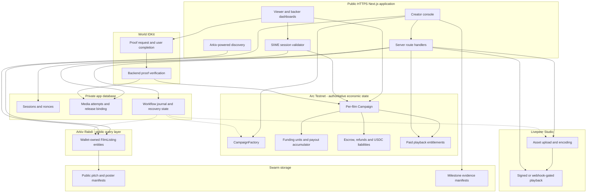
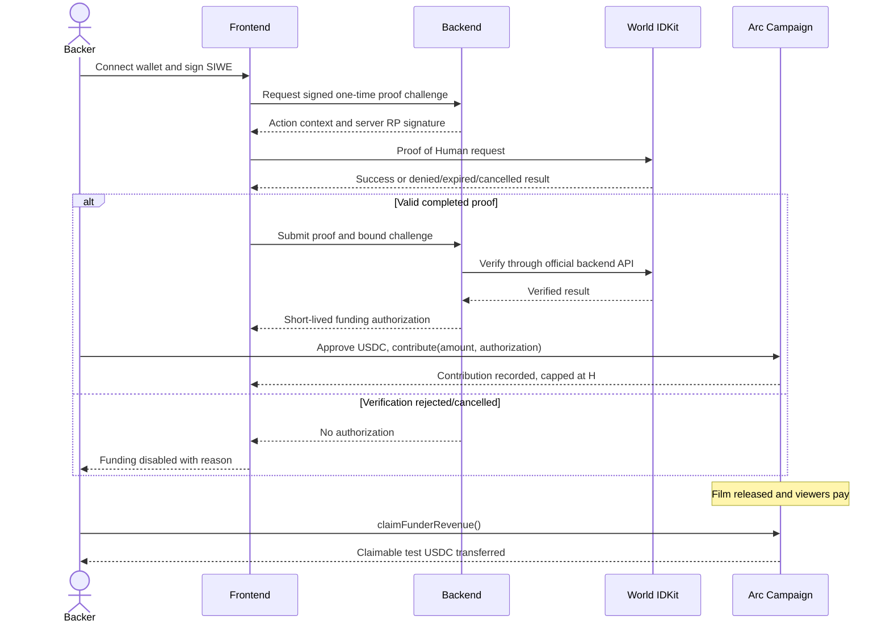
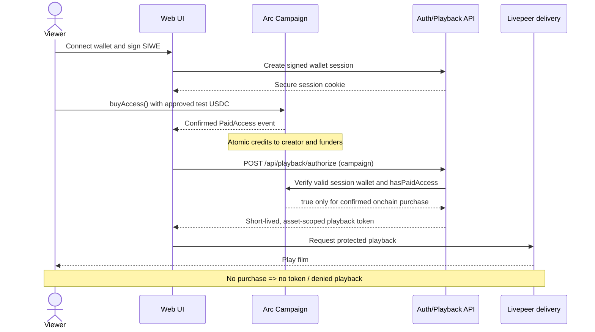
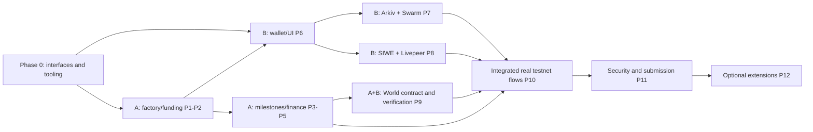

# Cinevest: Technical Specification and Hackathon Build Plan

> **Status:** Implementation blueprint, not deployed code. **Research checked:** 2026-11-03. **Event:** ETHGlobal Mumbai 2026. **Environment:** publicly accessible web application; **Arc Testnet + Arkiv Rabdi Testnet only**; no mainnet, real investment offering, or production-money flow.
>
> **Build rule:** Classic / From Scratch. Begin project-specific code only when ETHGlobal's official hacking window opens. Both teammates must register in the same participation track. Sponsor selections are limited by event rules; confirm the selections in the submission UI.
>
> **Single source of product truth:** Contracts on Arc determine all economic rights, funds, and viewing access. Arkiv is the public discovery database. Swarm stores manifests/evidence. Livepeer distributes the video. World IDKit protects a genuinely scarce funding allocation.
>
> **Reliability amendment (2026-11-05):** Research/audit findings are incorporated **inside Phases 7–12**, beginning with new follow-up slices immediately after **P7.7** (current implementation point). Completed work in Phases 0–5 is unchanged; outstanding fixes for **Phases 0–6 appear separately after Phase 12**. A `[NEW]` tag marks an added slice. New slices are unchecked, with one testable deliverable each. This amendment is a proposed work plan, not a claim that the new checks are already implemented.

## 1. What Cinevest is and what it solves

**Cinevest** is a film-production financing and pay-per-view settlement protocol. A creator posts a film proposal, chooses immutable funding terms, and raises test USDC from backers. Funded proceeds are released to the creator in controlled production milestones. Once a film is delivered through Livepeer, viewers buy access with test USDC on Arc; the contract automatically allocates each purchase between the creator and backers. Backers receive a **capped and time-limited contractual claim to eligible onchain receipts**, rather than permanent film copyright or ownership of a media file. Public film listings and production artifacts remain independently discoverable via Arkiv and Swarm.

**Problem addressed:** Creators need production capital before release; backers need transparent, enforceable payout terms; audiences need a simple way to purchase access; existing film-financing processes can depend on opaque payout reports and manual disbursements. Cinevest makes the receipts that actually enter its settlement contract and their allocation independently verifiable.

**Critical scope distinction:** The demonstrated revenue source is Cinevest pay-per-view USDC receipts**, not YouTube/ad-platform income. External advertising income is not controlled or guaranteed by the contract. Do not pitch the MVP as trustlessly tokenizing all future ad revenue. The working title “tokenized film receivables” refers to nontransferable accounting units during the hackathon; freely tradable investment tokens are deliberately excluded.

**Novel financial primitive:** creator-set, immutable revenue-sharing terms + milestone escrow + pro-rata backer claims + automatic cap/term maturity + auditable media release. The protocol is novel in its combination and execution, not the general concept of crowdfunding films.

**Target users:** independent filmmakers (campaign creators), film supporters (funding backers), viewers (access purchasers), and external builders (portable Arkiv discovery).

**Non-goals:** YouTube earnings scraping as financial truth; profit guarantees; royalty enforcement outside Cinevest; censorship-proof video DRM; KYC/compliance certification; mainnet; unrestricted secondary trading; autonomous AI-film production; multi-chain settlement.

## 2. Prize tracks and non-negotiable qualification evidence

| Partner selection | Selected bounty | Why it belongs | Evidence to submit |
|---|---|---|---|
| **Arc** | **Best Smart Contracts with Advanced Stablecoin Logic, In Arc Studio** | USDC escrow, milestone releases, revenue waterfall and capped claims | Begin in **Arc Studio**; shareable Studio project URL; show Studio in demo; Arc Testnet addresses, tests, frontend/backend, architecture diagram, GitHub and short video |
| **Arkiv** | **Build on Arkiv (from scratch)** | Indexed, expiring campaign listings actually queried in the user-facing marketplace | Entity write **and actual read**, author wallet(s), reproducible query, `arkiv/schema.md`, `arkiv/friction.md`, `arkiv/reach.md`, `arkiv/why-arkiv.md`, `arkiv/how-you-use-arkiv.md`; public licensed repo; disclose AI usage |
| **World** | **Best Use of IDKit** | Unique-human verification before scarce early funding allocation, rather than decorative login | Official IDKit; protected action; backend verification; successful and denied/cancelled/expired demo paths; brief integration feedback |
| **Arkiv bonus, not fourth partner** | **Arkiv + Swarm bonus (from scratch)** | Public proposal/milestone files stored on Swarm and referenced from Arkiv | `arkiv/swarm.md` with entity key, accessible reference, batch ID, Bee uploader, wallet, upload/read steps, code paths, demo timestamp, friction |

**Prize selection is a submission configuration, not a requirement to deploy four chains.** The event's up-to-three partner selection rule and same-participation-track rule remain binding. Use current [ETHGlobal Mumbai prizes](https://ethglobal.com/events/mumbai/prizes) immediately before submission; bounty amounts and details may change.

## 3. Deployment targets, network configuration, stack

| Responsibility | Choice | Notes |
|---|---|---|
| Web app + API | **Existing repository split:** `apps/web` and `apps/backend`, both Next.js App Router + TypeScript; deploy to **Vercel** | Mobile-responsive HTTPS; same-origin API routing for auth/market/playback (P6.10), not localhost-only |
| Onchain frontend | wagmi + viem + wallet connector | Wallet network guard for Arc versus Arkiv |
| Smart contracts and tests | Solidity 0.8.x, Foundry, OpenZeppelin 5.x | Create the starting Arc Studio project first, then export/commit/test locally |
| Financial settlement | **Arc Testnet**, chain ID **5042002**, RPC `https://rpc.testnet.arc.io` | Native gas is USDC with **18 decimals**; ERC-20 USDC interface uses **6 decimals** |
| ERC-20 USDC | `0x3600000000000000000000000000000000000000` | Verify on current Arc docs; do **not** use native-gas units in payout math |
| Discovery DB | **Arkiv Rabdi**, chain ID **7794095**, `@arkiv-network/sdk` | tGLM for Arkiv writes; read/write endpoints and access keys from current Arkiv docs |
| Proposal/evidence storage | Swarm through Bee-compatible upload service | Public, content-addressed poster/pitch/milestone manifest, **not** the paywalled film |
| Streaming | Livepeer Studio, video-on-demand | Private API credentials server-side; test supported JWT/webhook asset playback policy before relying on it |
| Identity | World IDKit Proof of Human, server verifier | Hackathon mock proofs are **not production identity assurance** |
| Auth | EIP-4361 SIWE + signed nonce, secure session cookies | Bind site domain, wallet, chain, expiry and nonce |
| Minimal application persistence | Neon or Supabase Postgres (server only) | Workflow journal/reconciliation, SIWE challenges, upload attempts, selected release, proof replay/idempotency; never authoritative for economic balances |
| Hosting keys | Deployment secret manager | Keep Studio/API/World/signing keys out of `NEXT_PUBLIC_*` and the repository |

**Public release:** `https://<deployment>.vercel.app` (or a team domain). All onchain transactions remain on testnets; test USDC has no monetary value. Site must show **TESTNET DEMO** and link to contract explorer transactions. Configure environment-specific domains for SIWE, webhooks and CORS. Deploy one stable environment before recording the video.

## 4. Architecture and trust boundaries



**Ownership and consensus:** Arc transactions settle USDC and grant access. Arkiv has independent chain state and optional delayed indexing; a listing is not proof a campaign exists, is funded, or is solvent. Every listing card resolves its `campaignAddress` against Arc before showing actionable financial state. A wallet that creates an Arkiv entity owns/controls it, and **only that wallet** normally updates it. The preferred demo is creator-owned publishing by briefly switching the creator wallet to Rabdi. If a relayer posts instead, the operator is the real Arkiv entity owner and the UI/docs must say so. An Arkiv owner is not assumed to control the Arc campaign merely because a listing says so; the app validates both the onchain creator and listing creator address.

**Availability and trust:** The `apps/backend` service is trusted to verify World proofs, coordinate cross-service operations and authorize media delivery, but cannot mint funder claims, move campaign escrow, or change immutable terms. The database workflow journal records attempts and reconciles confirmed outcomes; it cannot create cross-chain atomicity. Livepeer can deny normal stream playback, not prevent a paid viewer from recording/copying a film. Milestone reviewer judgments are explicitly **trusted human decisions**, not cryptographic evidence of film quality.

## 5. Data model and canonical identifiers

**Campaign identity:** `(arcChainId, campaignAddress)` is canonical; `campaignId` is a monotonic factory index for navigation. Validate `factory.isCampaign(address)` in all server endpoints. Use transaction receipts/events to learn newly deployed campaign addresses; never trust an arbitrary client-supplied address for sensitive actions.

**Immutable onchain campaign terms** (constructor or one-time `initialize`, no update setters):

```solidity
struct CampaignTerms {
    address creator;
    address reviewer;          // independent reviewer, not creator
    address usdc;              // fixed Arc Testnet ERC-20 predeploy
    uint256 fundingGoal;       // USDC base units (6 decimals)
    uint64 fundingDeadline;    // unix seconds, future
    uint64 productionDeadline; // deadline to deliver; later than funding deadline
    uint64 rightsDuration;     // seconds of sharing after actual film release
    uint256 watchPrice;        // USDC base units
    uint16 funderBps;         // e.g. 2000 = 20%
    uint16 repaymentCapBps;   // e.g. 15000 = 1.5x fundingGoal
    bytes32 pitchReference;    // public Swarm 32-byte content reference
    bool worldGated;          // immutable for this campaign
    uint256 perHumanLimit;    // USDC base units, if gated
}
```

**Mutable Arc state:** `raised`, `refundsPaid`, `productionPaid`, `funderAllocated`, `funderClaimed`, `creatorAllocated`, `creatorClaimed`, `accRewardPerUnit`, `scaledRemainder`, `contribution[wallet]`, `funderClaimedBy[wallet]`, `hasAccess[wallet]`, `usedNullifierOwner[hash]`, `usedAuthorizationDigest[digest]`, milestone evidence hashes, reviewer approval/dispute flags, `releasedAt`, `livepeerPlaybackIdHash`. Store `campaignStage` as `Funding | Refundable | Production | Released | CancelledProduction`; **rights maturity is computed from expiry/cap and does not disable paid viewing**.

**Arkiv `Cinevest.film.v1` schema** (indexed where used for filtering): `arcChainId:u64`, `campaignAddress:addr` (indexed), `creatorAddress:addr` (indexed), `genre:str` (indexed), `fundingDeadline:u64` (indexed), `title:str`, `pitchSwarmRef:str`, `posterSwarmRef:str`, `termsDigest:str`, `createdAt:u64`, `schemaVersion:u64`. Ensure strings fit Arkiv's **128-byte `str` limit** and use at most 31 custom columns with a named schema. Do not store ephemeral economic balances or private media URLs. `stage` shown on a card must come from Arc, not an outdated Arkiv attribute. Initial listing expiry: 30 days or closest supported duration; renewal only by entity owner. If a listing expires it disappears from Arkiv queries; Arc funds and rights remain unchanged. [Arkiv schema/limits](https://docs.arkiv.network/reference/limits/), [expiration](https://docs.arkiv.network/writing/expiration/).

**Public Swarm manifest** (JSON, versioned, never contains secrets):

```json
{
  "schema": "Cinevest.pitch.v1",
  "title": "Example Film",
  "synopsis": "...",
  "posterRef": "<public-swarm-reference>",
  "genre": "short-film",
  "creator": "0x...",
  "rightsNotice": "Copyright remains with the creator",
  "manifestVersion": 1
}
```

A `Cinevest.milestone.v1` manifest adds `campaignAddress`, `milestoneIndex`, `evidenceFiles[ ]`, `submittedAt` and public text. The original pitch reference is immutable on Arc; milestone evidence can be superseded only before reviewer approval and emits an event. Upload production evidence that is explicitly safe to publish; **Swarm encrypted references contain the decryption key**, so do not put complete private references into public Arkiv fields.

**Private app DB** (small tables): `siwe_nonces(wallet,nonce_hash,expires_at,used_at)`, `media_assets(campaign,asset_id,playback_id,status,owner_wallet)` (initial Phase 0 scaffold), `world_verifications(campaign,scoped_nullifier_hash,wallet,verified_at)`, `proof_challenges(nonce, wallet,campaign, expires_at, consumed_at)`. **Phase 7.7a** adds `workflow_operations` for durable cross-service recovery. **Phase 8.1a** splits the original single-media mapping into `media_uploads` (retryable attempts) and `campaign_media_release` (selected immutable release), with migration of any existing rows. Unique indexes on nonce/idempotency keys, canonical `(arc_chain_id,campaign_address)`, and `(campaign,scoped_nullifier_hash)`; no database column is a replacement for contract balances.

## 6. Contract API, lifecycle and permissions

```mermaid
stateDiagram-v2
    [*] --> Funding: create campaign
    Funding --> Production: goal reached / finalize
    Funding --> Refundable: deadline passed below goal
    Refundable --> Refundable: backers claim refunds
    Production --> Production: approve preproduction / rough-cut tranches
    Production --> Production: evidence submitted, reviewed, or disputed
    Production --> Released: final milestone approved, film configured
    Production --> CancelledProduction: reviewer cancellation after dispute policy
    CancelledProduction --> CancelledProduction: claim pro-rata remaining escrow
    Released --> Released: paid watches and funder claims
    Released --> Released: rights cap / term matures; creator gets future receipts
```



**Design state transitions:** a fully funded campaign cannot revert to refundable funding; a campaign with insufficient funds can only fail after the deadline. Funding stops at the exact goal and cannot accept overfunding. `finalize()` can be called by anyone after reaching goal, so it cannot be held hostage by the creator. A creator can submit evidence and request tranches, but cannot approve their own rough-cut/final release. The designated reviewer (explicitly centralized for MVP) can approve/reject/dispute. A dispute freezes **unreleased production escrow**, not previously accrued viewer/funder balances. In a cancelled production, remaining unspent escrow is refundable pro rata; any released production money is economically at risk. No viewers may buy an unreleased or cancelled film.

**Functions, grouped for one or two contracts:**

| Component | External API | Role / guards |
|---|---|---|
| `CampaignFactory` | `createCampaign(terms)`, `isCampaign(address)`, `campaignAt(index)` | Anyone can create valid terms; fixed USDC/testnet configuration |
| `Campaign` funding | `contribute(amount[, authorization])`, `finalize()`, `expire()`, `claimFundingRefund()` | Before deadline and until goal; authorized World attestation if world-gated; refunds only in failed state |
| `Campaign` milestones | `submitEvidence(stage,swarmRef)`, `approveStage(stage)`, `disputeStage(stage)`, `resolveStage(stage,decision)`, `claimApprovedTranche()` | Only creator submits/withdraws; only independent reviewer approves/resolves; monotonic approvals |
| `Campaign` film | `configureRelease(playbackIdHash)`, `publishFilm()`, `buyAccess()`, `hasPaidAccess(wallet)` | Release needs final milestone and configured Livepeer asset; one paid purchase/access per wallet |
| `Campaign` distributions | `claimFunderRevenue()`, `claimCreatorRevenue()`, `claimCancelledEscrow()` | Pull claims; exact accounting; non-reentrant |
| Views | `getTerms()`, `getStage()`, `isRevenueRightMature()`, `claimableFunder(wallet)`, `escrowLiability()`, `reservedUSDC()` | Read-only and deterministic |

**Milestone schedule** uses `40% / 30% / 30%` of successfully raised principal. Tranche 0 becomes available on successful finalization (creator can withdraw for production). Tranche 1 requires reviewer approval of a public rough-cut evidence manifest. Tranche 2 requires reviewer approval of a final-release manifest plus a configured Livepeer asset; final approval moves to `Released`. Tranche amounts are calculated **cumulatively** rather than with three independent rounded percentages: `T0=floor(40F/100)`, `T1=floor(70F/100)-T0`, `T2=F-T0-T1`. Thus all three sum exactly to `F`. Creator withdrawal is separate from approval and always decrements escrow liability before external USDC transfer.

**Dispute policy for the demo:** a backer with a positive funding balance can flag a submitted milestone; the reviewer must explicitly resolve it before approving. For bounded onchain cancellation, configure an immutable `productionDeadline` after the funding deadline; after that timestamp the reviewer can cancel an unreleased production, disputed or not, and distribute only remaining escrow to contributors. This is a trusted-reviewer prototype; production use requires independent arbitration, appeals, and legal terms. A reviewer cannot seize funds. A cancellation cannot transfer previously disbursed funds back from the creator. A completed release cannot be cancelled through this production-cancellation path.

## 7. Financial math and invariants

### 7.1 Constants and entitlement units

All payment values are unsigned **USDC base units (6 decimals)**. Define `BPS = 10000` and `Q = 10^27` for magnified accounting. When funding completes:

$$
F=\sum_{u} c_u=\text{fundingGoal},\qquad S=\sum_{u} c_u=F
$$

where `c_u` is wallet `u`'s accepted contribution; nontransferable claim units are simply `units_u=c_u`. `S>0`. Contributions/units freeze on finalization. A funder can retain receipt units and purchase viewing access separately. No rights are minted by just watching a video.

The collective cap is fixed:

$$
C=\left\lfloor\frac{F\cdot \mathrm{repaymentCapBps}}{10000}\right\rfloor
$$

Choose `repaymentCapBps=15000` (1.5× funding) and `funderBps=2000` (20% of eligible watch receipts) for the explanatory example. This is a **cap on aggregate distributions**, not a guaranteed return or a price for a tradable token.

### 7.2 Per-purchase allocation and maturity

For each distinct authorized viewer purchasing a released film at price `p`:

$$
B_i=\begin{cases}
\min\left(\left\lfloor\frac{p\alpha}{10000}\right\rfloor,C-A_{i-1}\right),&t_i<T\ \land\ A_{i-1}<C\\
0,&\text{otherwise}
\end{cases}
$$

$$
K_i=p-B_i,\qquad A_i=A_{i-1}+B_i
$$

Here `α=funderBps`, `A_i` is **cumulative allocated** funder revenue (including unclaimed amounts), and `T=releasedAt+rightsDuration`. **The sharing term starts at actual publication**, not campaign creation, so a creator cannot defeat the backers' rights merely by publishing late. `productionDeadline` independently bounds the time before unresolved production can be cancelled. Use allocated rather than withdrawn amounts for the cap so a slow claimant cannot extend economics beyond the agreed limit. When `A_i=C` or `block.timestamp>=T`, new payments go entirely to creator. Already accrued claims remain claimable. If the price changes are not part of the original agreement, **do not allow a price setter** in this MVP.

**Example:** $100 funded, $2 per view, 20% to funders, $150 cap. Each eligible paid view allocates $0.40 to the collective funder liability and $1.60 to creator until the cap binds. The 375th view brings cumulative funder allocations to $150; subsequent payments credit the creator $2. Viewers may still watch after funder-right maturity.

### 7.3 Gas-bounded pro-rata claims with rounding

No `for each funder` loop is permitted in a purchase or claim transaction. Let `r` be the magnified cumulative reward per unit, and `z` a scaled remainder. On each purchase with funder allocation `B_i`:

$$
x_i=B_i Q+z_{i-1},\quad \Delta r_i=\left\lfloor\frac{x_i}{S}\right\rfloor,\quad z_i=x_i\bmod S,\quad r_i=r_{i-1}+\Delta r_i
$$

For wallet `u`:

$$
\mathrm{claimable}_u=\left\lfloor\frac{c_u r_i}{Q}\right\rfloor-\mathrm{alreadyClaimed}_u
$$

The contract first increments `alreadyClaimed_u` and `funderClaimed` and then uses `SafeERC20.safeTransfer` under a non-reentrant guard. Because `c_u` never changes after funding, this **cumulative entitlement minus cumulative paid** model avoids retroactive share changes. Every claim must satisfy `claimable<=funderAllocated-funderClaimed`. Test arbitrary contribution splits and many tiny purchases. **Rounding dust remains a contract liability**, not creator profit; do not silently sweep it before an explicitly defined final-claim policy. For the hackathon, leave dust locked rather than build a dangerous sweep function.

### 7.4 Principal escrow, refunds and solvency

Let `R` be principal refunded, `P` the total creator principal withdrawn, `A` the aggregate funder revenue allocated, `D` funder revenue already withdrawn, `K` creator revenue allocated, and `W` creator revenue already withdrawn. Define the remaining principal liability:

$$
E=F-R-P
$$

with mutually exclusive stage constraints: while `Refundable`, `P=0`; while a successful campaign is active, `R=0`. On a **cancelled production**, the remaining principal `E` becomes a distinct refund pool with per-contributor entitlements; it must not simultaneously remain withdrawable by the creator.

The total reserved test USDC is:

$$
L=E+(A-D)+(K-W)
$$

**Primary solvency invariant:**

$$
\operatorname{balanceOf}_{USDC}(campaign)\geq L
$$

Under normal transfers of the fixed token and without direct third-party donations, equality should hold after every successful operation. Direct ERC-20 transfers into the address may produce a positive surplus, which must **never** be mistaken for eligible viewing revenue or available escrow. For cancelled production, `E` decreases only through pro-rata claims, and any already approved but unwithdrawn milestone is permanently invalidated. Where `F` is not yet finalized it denotes funds accepted to date, not the target.

**Cancelled-escrow formula:** At cancellation, snapshot `E_cancel=F-P` (no successful campaign principal refunds have occurred before cancellation). Each funder has a cumulative cancellation refund entitlement:

$$
J_u=\left\lfloor\frac{c_u E_{cancel}}{S}\right\rfloor,\qquad
\mathrm{cancelClaimable}_u=J_u-\mathrm{cancelPaid}_u
$$

Take the snapshot **once**, before any refund is claimed; never recompute the numerator from the decreasing live escrow balance, because earlier claimants would reduce later claimants' entitlements. Record each claimant's settled amount and decrement `E` by the actual transfer. The per-wallet floors can leave dust: retain it as an outstanding liability rather than allowing the creator to claim it. This is deliberately not a promise to recover tranches already paid to the creator.

**Core invariants to assert in Foundry:**

| ID | Invariant | Required negative case |
|---|---|---|
| `I01` | Only designated USDC is accepted; amounts use 6-decimal units | Unsupported token / zero contribution |
| `I02` | `0 <= raised <= fundingGoal`; no contributions after goal/deadline | Overfunding / late contribution |
| `I03` | Failure permits only the original contributor's remaining refund; no double refund | Repeat refund and wrong-wallet refund |
| `I04` | Funded principal and failed-refundable principal are mutually exclusive | `refund()` after successful finalize |
| `I05` | `sum(trancheAmounts)=F`, no tranche paid twice | Repeated withdrawal / approval |
| `I06` | Creator never approves own evidence; reviewer never withdraws creator's funds | Role bypass |
| `I07` | Dispute blocks the affected stage; past paid tranches cannot be clawed back | Disputed milestone payment |
| `I08` | Cancellation distributes only **unspent** principal, never newly minted funds | Cancel after 40% spent |
| `I09` | Film releases only after final approval and nonzero asset reference | Publish before Livepeer ready |
| `I10` | An address gets paid-access entitlement at most once per campaign | Double purchase / duplicate event |
| `I11` | `0<=A<=C`; each payment satisfies `B_i+K_i=p`; term starts at `releasedAt` | Exact cap crossing, delayed-release and expiry boundary |
| `I12` | Claimable funder share is pro rata, nonnegative, and cannot be claimed twice | Multiple backers, rounding edge |
| `I13` | `A-D>=0` and `K-W>=0`; only beneficiary can withdraw | Non-beneficiary claim |
| `I14` | Contract USDC balance always covers `L` | Interleaved refund/escrow/watch/claims |
| `I15` | Immutable terms cannot change after factory deployment | Unauthorized setter |
| `I16` | No unbounded loops over backers or viewers | 100+ simulated funders |
| `I17` | Reentrant transfer path cannot double spend liabilities | Malicious mock ERC-20 callback |
| `I18` | Backend never issues playback credentials without confirmed paid entitlement + valid SIWE wallet | Forged tx hash or session |
| `I19` | World-gated contribution requires unique, unexpired, wallet-bound verified authorization | Replayed proof, new wallet same human |
| `I20` | Arkiv/Swarm or DB data never overrides Arc financial status | Stale or spoofed listing |

### 7.5 World allocation accounting

A **World-gated** campaign has a fixed per-human accepted funding limit `H` and a scarce pool (`fundingGoal` for MVP, optionally a separate capped verified tranche as an extension). Server verifies the World proof with the official verification API, checks the intended `action/signal` binds the **SIWE-authenticated wallet and campaign**, and returns an EIP-712 signed funding authorization containing `{chainId, campaign, wallet, scopedNullifierHash, maxAccepted, nonce, expiry}`. The contract verifies the designated attestation signer's signature, unexpired deadline, wallet and campaign binding, checks/consumes `usedAuthorizationDigest[digest]` for one-time authorization, and requires `contribution[wallet]+amount<=H`. A second legitimate contribution needs a new authorization for the same bound wallet and identity; the backend may reissue it without asking for another World proof while the verified session remains valid. An onchain `nullifierOwner[scopedHash]` mapping binds each **campaign-scoped** identifier to exactly one wallet. Subsequent contributions using that identifier may only come from its first wallet. The signer cannot move money; it only vouches for a recently verified human.

**Attestation signer:** The factory fixes a trusted `worldVerifierSigner` address for each created campaign. The EIP-712 domain must include the campaign contract, Arc chain ID, and a schema version. All `contribute` entrypoints must apply the verification guard for world-gated campaigns, including any overload; a public contribution method must not bypass it. Rotate compromised signer keys only through an explicitly disclosed emergency policy (the hackathon MVP instead redeploys new campaigns).

**Important implementation condition:** Verify which stable verified identifier/nullifier and signal binding the **current IDKit version** exposes. The contract-level uniqueness guarantee depends on the verifier supplying a stable same-human identifier scoped to the campaign. If the SDK/proof type cannot support that guarantee, do not claim rigorous per-human enforcement; use a server-side uniqueness proof-of-concept, document its trusted boundary, and demonstrate that failed verification blocks the contract authorization. Never publish raw identity proofs or World API secrets in Arkiv/Swarm.

## 8. User-facing journeys

### 8.1 Creator: upload pitch, raise, deliver

```mermaid
sequenceDiagram
    actor C as Creator
    participant W as Web UI
    participant S as Swarm
    participant A as Arc Factory/Campaign
    participant K as Arkiv Rabdi
    participant L as Livepeer
    C->>W: Author film pitch and fixed financing terms
    W->>S: Upload public poster + pitch manifest
    S-->>W: Public content reference
    C->>A: Create campaign (Arc Studio-derived contract)
    A-->>W: CampaignCreated address and ID
    C->>K: Switch to Rabdi, sign FilmListing write
    K-->>W: Entity key, indexed query result
    Note over W,A: Backers fund; target reached; production stage
    C->>A: Claim approved 40% preproduction tranche
    C->>S: Upload public rough-cut evidence
    C->>A: Submit evidence reference
    Note over A: Reviewer checks and approves; tranche unlocks
    C->>L: Upload final film through server-managed API
    L-->>W: Asset ID + playback ID, processing completed
    C->>S: Upload final-release evidence
    C->>A: Submit final evidence and playback ID hash
    Note over A: Reviewer approves final stage
    A-->>W: Released; viewers may purchase access
```

### 8.2 Backer: unique-human financing and claims



### 8.3 Viewer: paid playback and revenue allocation



**Gate rules:** enforce the playback policy at Livepeer/CDN, not only by hiding a button. A user presenting an arbitrary transaction hash or borrowing someone else's frontend session must fail server-side checks. Use the **current supported asset** JWT or webhook policy, documented callbacks and signing keys; verify a direct unauthenticated media request fails before declaring the gate done. A purchase is one-time permanent campaign access during the configured published lifetime, not a per-second streaming charge. The viewer wallet may be a funder too.

## 9. API endpoints and frontend screens

### Server endpoints

| Method/path | Input | Validations / output |
|---|---|---|
| `GET /api/health` | none | Build SHA, network IDs, readiness only; no secrets |
| `GET /api/auth/nonce` | wallet | Random one-time SIWE nonce, expiry, CSRF/session binding |
| `POST /api/auth/verify` | SIWE message/signature | Domain, chain, nonce, expiry, signature; session cookie, consumed nonce |
| `POST /api/films/upload` | creator session, canonical campaign, upload metadata | Arc creator check; request direct Livepeer upload URL; persist attempt and provider asset ID; do not proxy large files |
| `GET /api/films/:campaign/processing` | authorized creator | Livepeer processing state; no private asset keys |
| `POST /api/playback/authorize` | viewer session, campaign | Canonical factory campaign, released state, Arc `hasPaidAccess`; signed/approved playback credential |
| `POST /api/world/challenge` | SIWE session, campaign | Gated campaign + scoped challenge + RP signature |
| `POST /api/world/verify` | proof + challenge | Official backend proof verification, uniqueness, one-time challenge; EIP-712 contribution authorization |
| `GET /api/market` | genre, deadline, opaque cursor, optional owner for creator dashboard | Global Arkiv query across owners by default; owner filter only for creator view; bounded pagination, validation and Arc hydration; never invent financial totals |
| `GET /api/workflows/:operationId` | authenticated creator session | Return state and confirmed Arc/Arkiv/Swarm identifiers for recovery; no transaction-signing secret |

Do not add API endpoints that write Arc financial state using a backend owner key. Every financial action is a wallet transaction visible in the UI. Use a bounded RPC confirmation policy, network-specific addresses, and graceful transient failures.

### Pages/components

| Page | Essential actions |
|---|---|
| `/` | Film discovery from real Arkiv query; genre/deadline filters; funding/released tags derived from Arc |
| `/create` | Terms editor with explicit risk summary; public pitch+poster upload to Swarm; deploy campaign; write Arkiv listing |
| `/film/[arcChainId]/[campaignAddress]` | Canonical Arc identity; direct access survives Arkiv expiry; pitch, funding, milestone trail, purchase and playback actions |
| `/dashboard/creator` | Tranche withdrawal, evidence submission, video processing state, revenue claims |
| `/dashboard/backer` | Contribution units, claimable test USDC, remaining cap, maturity, refund/cancel claims |
| `/watch/[arcChainId]/[campaignAddress]` | Signed-in, onchain-entitled playback only; unauthorized and processing-failure screens |
| `/demo` | Stable fixture film and public URLs/addresses to reproduce both success and failure paths |

**UX requirements:** explicit network badges, testnet warning, numeric precision (USDC six decimals), transaction pending/success/failure, wallet reconnect, source explorer links, accessible video controls, funding risks and no guaranteed return language. No simulated balances or hardcoded successful transactions on the public demo.

## 10. Repository boundaries and conventions

```text
Cinevest/
  apps/web/                 # Existing Next.js client, wallet actions, routes
    app/                    # pages (and only explicitly owned web API routes)
    components/             # wallets, campaign state, creator/backer/viewer
    lib/arc/                # viem contracts and client-side receipts
    lib/arkiv/              # wallet-owned Arkiv writer, network switching
  apps/backend/             # Existing Next.js private integration service
    app/api/                # auth, market, workflows, playback and uploads
    lib/arkiv/              # discovery, schema validation, Arc verification
    lib/swarm/              # Bee upload/read and manifest validation
    lib/livepeer/           # Studio API adapter, authorization and policy
    lib/world/              # backend proof verification, attestation signer
    lib/auth/               # SIWE, sessions and nonce validation
    lib/db/                 # Drizzle/Postgres app state and workflow journal
  contracts/
    src/CampaignFactory.sol
    src/Campaign.sol
    test/                   # deterministic tests and stateful invariants
    script/Deploy.s.sol
  packages/abi/             # versioned ABI + typed deployment addresses
  arkiv/                    # sponsor evidence files listed above
  scripts/                  # testnet seed, Arkiv query, Swarm upload/read
  .env.example              # variable NAMES only
  README.md
  ARCHITECTURE.md
  FEEDBACK.md                # actual sponsor integration feedback if needed
```

**Preferred simplicity:** use **one `Campaign` contract per film, plus a factory**, with the ledger/escrow/milestone logic implemented as internal modules rather than many separately deployed proxies. Avoid upgradeability and owner-controlled economic changes. TS full-stack is recommended because the external partner SDKs are primarily JS/TS, and a single codebase minimizes integration time; Go/Rust microservices are unnecessary for this demo.

**Team ownership:** Engineer A handles Arc contracts, accounting, Foundry tests, Arc Studio, deployment and chain reads. Engineer B handles Next.js, Arkiv/Swarm, World, Livepeer, server and hosting. They coordinate against the interim ABI throughout implementation and jointly integrate after the final Phase 9 ABI regeneration. Commit in small working slices. Every slice below should be submitted as a **single focused coding prompt**, ideally one function/file/test; the five-minute target is a scope budget, not an execution guarantee.

## 11. Phased build: small, independently verifiable slices

**How to execute:** Each line is a self-contained agent slice with a bounded output. Give the agent this spec, current repository status and the slice ID. Ask it to implement **only that slice**, run the stated check, and report changed files plus evidence. Never combine unrelated slices. `A` = contract engineer; `B` = app/integration engineer; `Both` = shared integration. Order within a phase is generally sequential; independent A/B phases may proceed in parallel after the interface milestone.

**Amendment execution rule:** The developer is currently at **P7.7**. Complete and verify P7.7, then follow **P7.7a → P7.7b → ... → P7.8**. New slices with a letter suffix are inserted directly after the relevant existing slice; do not rerun completed P7.1–P7.6 merely because new recovery checks exist. Fixes from older phases appear in a separately prioritized backlog after Phase 12. **Complete the contract-blocking older fixes before P9.6/P10.1**; all other older fixes can be batched when their dependency is encountered.

### Phase 0 — legal hackathon start, environment and shared interfaces

- [ ] **P0.1 (Both):** Confirm official Classic hacking start/eligibility, select Arc + Arkiv + World and Arkiv+Swarm; record links in README. **Done:** written checklist, no project code committed early.
- [ ] **P0.2 (A):** Start a **shareable Arc Studio project** with the agreed Cinevest prompt; record URL. **Done:** Studio project opens for judges.
- [ ] **P0.3 (Both):** Create monorepo and minimal README/license after hacking starts. **Done:** `pnpm install` and root scripts work.
- [ ] **P0.4 (A):** Initialize Foundry, pinned OpenZeppelin dependencies, formatting and compile command. **Done:** `forge build` passes.
- [ ] **P0.5 (B):** Scaffold Next.js TypeScript app and base layout. **Done:** homepage runs locally.
- [ ] **P0.6 (Both):** Add `packages/abi` placeholders plus typed chain/campaign interface contract. **Done:** web imports ABI/types without app crashes.
- [ ] **P0.7 (B):** Add `.env.example`, validation schema and `.gitignore` for all secrets. **Done:** missing required variables fail safely; no private keys committed.
- [ ] **P0.8 (Both):** Add CI for typecheck, lint, `forge test`, no-mainnet-address assertion. **Done:** workflow runs on a clean checkout.

### Phase 1 — immutable campaign factory and contract state (A)

- [ ] **P1.1:** Define `CampaignTerms` struct and bounded validation of goal/price/bps, funding deadline, production deadline, sharing duration and addresses. **Done:** invalid terms revert in a small unit test.
- [ ] **P1.2:** Add fixed testnet USDC constant and chain guard to factory constructor/deployment. **Done:** incompatible chain/config cannot be deployed inadvertently.
- [ ] **P1.3:** Define campaign enum and immutable term getters. **Done:** fresh campaign reports `Funding` with correct values.
- [ ] **P1.4:** Implement `CampaignFactory.createCampaign` deploying new campaign and emitting canonical event. **Done:** event includes film address and creator.
- [ ] **P1.5:** Implement factory registry `isCampaign`, `campaignAt`, count. **Done:** unknown address is rejected.
- [ ] **P1.6:** Add milestone tranche amount getters using cumulative 40/70/100 percent math. **Done:** tiny/non-divisible funding goals sum exactly.
- [ ] **P1.7:** Add fixed event definitions for funding, stage, evidence, watch, credit, claim, proof and cancellation. **Done:** ABI compiles and can be consumed by web.

### Phase 2 — funding and failed-campaign refunds (A)

- [ ] **P2.1:** Implement contributions that **revert** if they exceed remaining funding goal. **Done:** exact goal may be reached, never overfunded.
- [ ] **P2.2:** Add USDC `safeTransferFrom` and contribution units by wallet. **Done:** recorded principal matches token balance.
- [ ] **P2.3:** Implement success `finalize()` by anyone. **Done:** goal reached transitions once to `Production`.
- [ ] **P2.4:** Implement deadline-driven failure `expire()`. **Done:** below-target campaign moves to `Refundable` after deadline.
- [ ] **P2.5:** Implement `claimFundingRefund()` using checks-effects-interactions and reentrancy guard. **Done:** only original contributions refundable, once.
- [ ] **P2.6:** Add success/failure/refund edge-case tests. **Done:** wrong-wallet, double-refund, over-goal and late-funding tests pass.
- [ ] **P2.7:** Export new contract ABI and addresses/types to shared package. **Done:** frontend can call funding and read stage.

### Phase 3 — controlled production escrow, evidence, disputes (A)

- [ ] **P3.1:** Implement tranche-0 authorization on successful finalization. **Done:** exactly 40% is withdrawable by creator.
- [ ] **P3.2:** Implement `submitEvidence(1,swarmRef)` with nonzero immutable-until-review reference. **Done:** only creator can submit.
- [ ] **P3.3:** Implement reviewer-only tranche-1 approval. **Done:** rough-cut approval unlocks exactly 30%.
- [ ] **P3.4:** Implement `claimApprovedTranche()` with cumulative paid-tranche tracking. **Done:** repeated call cannot pay twice.
- [ ] **P3.5:** Implement `disputeStage` restricted to genuine contributing backers. **Done:** dispute blocks unpaid milestone withdrawal.
- [ ] **P3.6:** Implement reviewer dispute resolution event and state transition. **Done:** approved/rejected outcome is publicly visible.
- [ ] **P3.7:** Implement immutable production deadline and reviewer cancellation of unreleased production after it. **Done:** cannot cancel released or prematurely.
- [ ] **P3.8:** Implement cancellation-time refund snapshot and pro-rata claim of **remaining** escrow. **Done:** claim order independent, no recovery of spent tranches.
- [ ] **P3.9:** Add tranche/dispute/cancellation regression tests. **Done:** `I05–I08` pass.

### Phase 4 — film release, paid viewing and revenue accounting (A)

- [ ] **P4.1:** Add final evidence submission and reviewer approval. **Done:** unreleased campaign cannot open paywall prematurely.
- [ ] **P4.2:** Add `configureRelease(playbackIdHash)` only creator, nonzero hash. **Done:** release source recorded before publication.
- [ ] **P4.3:** Add `publishFilm()` final-stage guard; emit released event. **Done:** only final-approved campaign enters `Released`.
- [ ] **P4.4:** Add `hasAccess[wallet]` and `buyAccess()` once per wallet, with USDC transfer. **Done:** double purchase rejected.
- [ ] **P4.5:** Implement cap/expiry bounded `B_i` and complementary `K_i`. **Done:** exact equality and cap test pass.
- [ ] **P4.6:** Implement cumulative reward index `r` plus scaled remainder `z`. **Done:** one purchase touches O(1) funder state.
- [ ] **P4.7:** Implement `claimableFunder(wallet)` view. **Done:** weighted pro-rata results for two contributors.
- [ ] **P4.8:** Implement `claimFunderRevenue()` and claimed tracking. **Done:** repeat claim pays zero/reverts harmlessly.
- [ ] **P4.9:** Implement `claimCreatorRevenue()` with creator-only authorization. **Done:** creator withdraws only credited funds.
- [ ] **P4.10:** Implement `reservedUSDC()` and invariant views. **Done:** stage-by-stage liability matches expected test value.
- [ ] **P4.11:** Test delayed release, release-relative expiry and cap crossing. **Done:** backers retain full sharing duration after publication; post-maturity purchases still work.

### Phase 5 — safety harness and deterministic tests (A)

- [ ] **P5.1:** Add funding/refund Foundry fuzz harness for arbitrary goal/contributor amounts. **Done:** `I01–I04` invariants.
- [ ] **P5.2:** Add tranche/dispute state-machine fuzz sequences. **Done:** `I05–I09` invariants.
- [ ] **P5.3:** Add two-to-many funder reward distribution fuzz cases. **Done:** nonnegative, bounded claimable values.
- [ ] **P5.4:** Add cap-crossing and exact-expiration boundary fuzz cases. **Done:** `I10–I12` pass.
- [ ] **P5.5:** Add solvency invariant handler interleaving purchase/claim/refund/escrow operations. **Done:** `I13–I14` hold.
- [ ] **P5.6:** Add malicious token/reentrancy test double. **Done:** no extra liabilities withdrawn.
- [ ] **P5.7:** Add gas report with 100+ backers and invariant that purchase cost does not scale linearly with backers. **Done:** report artifact in repo.
- [ ] **P5.8:** Add Foundry snapshot fixture with $100 funding / $2 viewing / 20% / 1.5× cap. **Done:** expected accounting assertions pass.

### Phase 6 — wallet, contract reads and the finance UI (B)

- [ ] **P6.1:** Configure wagmi/viem for **Arc Testnet only** and wallet connect. **Done:** wrong-network call prompts switch.
- [ ] **P6.2:** Add ABI-based `getTerms/getStage/claimable` hooks and error boundaries. **Done:** chain views show real values.
- [ ] **P6.3:** Create finance-terms form with bps, funding goal, price and expiry validation. **Done:** invalid input cannot deploy.
- [ ] **P6.4:** Create campaign detail page with exact USDC display and progress. **Done:** reads real contract, no mock totals.
- [ ] **P6.5:** Build approve+contribute UX with receipt confirmation. **Done:** contribution updates after confirmed block.
- [ ] **P6.6:** Build failed funding refund action and disabled-state messages. **Done:** refund claim works from UI.
- [ ] **P6.7:** Build backer accrued amount and `Claim` action. **Done:** claimed balance updates from Arc.
- [ ] **P6.8:** Build creator tranche/revenue claim buttons with state guards. **Done:** rejects unauthorized wallet and locked funds.
- [ ] **P6.9:** Build creator evidence+reviewer milestone panels. **Done:** submit/approve/dispute states visible.

### Phase 7 — Swarm artifacts and Arkiv discovery (B)

- [ ] **P7.1:** Configure Bee uploader credentials, postage-batch parameters and health check. **Done:** staging Bee read/write works.
- [ ] **P7.2:** Create validated `Cinevest.pitch.v1` manifest encoder. **Done:** stable JSON bytes/digest and schema test.
- [ ] **P7.3:** Add public poster and pitch upload to Swarm and read-back verification. **Done:** retrieved bytes match locally.
- [ ] **P7.4:** Add `Cinevest.milestone.v1` public evidence upload/read helper. **Done:** hash visible in UI.
- [ ] **P7.5:** Define named Arkiv schema with indexed genre/deadline/creator. **Done:** under 31 attributes and 128-byte string limits.
- [ ] **P7.6:** Implement creator-owned Arkiv `createEntity` on Rabdi (with explicit wallet switch). **Done:** writer address and entity key logged.
- [ ] **P7.7:** Implement real Arkiv query by genre, funding deadline and pagination. **Done:** homepage pulls entity on fresh reload.
- [ ] **P7.7a (B) [NEW]:** Add `workflow_operations` table and migration with stable operation ID, actor, canonical Arc campaign ID, request digest, provider tx/entity IDs, status, retry count and timestamps. **Done:** migration plus unique-key/atomic-status-transition tests pass.
- [ ] **P7.7b (B) [NEW]:** Add a recoverable creator-publication journal for Swarm → Arc → Arkiv: persist the wallet-returned Arc tx hash before receipt polling, reconcile factory `CampaignCreated` on uncertainty, and retry **only** missing Arkiv publication for an already confirmed campaign. **Done:** a lost Arkiv response never causes a second Arc contract deployment.
- [ ] **P7.7c (B) [NEW]:** Split global discovery (all owners) from the creator dashboard (`ownedBy` only for the connected creator); never use `createdBy` as an implicit ownership substitute. **Done:** two creator-owned listings appear publicly while each wallet sees only its own dashboard items.
- [ ] **P7.7d (B) [NEW]:** Implement stable `asc("$key")` cursor pagination using Arkiv `gt("$key", key(lastKey))` when scanning the named schema. **Done:** inserts/expiry between pages do not repeat an already emitted key; page size is bounded.
- [ ] **P7.7e (B) [NEW]:** Handle Arkiv schema-mismatch pagination explicitly: `onMismatch: "throw"` can block a forged/malformed page, while skipped rows can leave no cursor. Return a typed partial/unavailable result, stop bounded scans safely and test malformed entities; a bounded offset fallback must be labeled best-effort and never presented as complete. **Done:** no infinite loop, hidden infinite retry or false claim of complete results.
- [ ] **P7.7f (B) [NEW]:** Add Arkiv RPC timeout, rate-limit backoff and a maximum candidates/pages budget with a stable opaque continuation cursor. **Done:** synthetic 429/timeout tests return a retryable page and do not lose accepted results.
- [ ] **P7.8:** Filter by real `$owner`, validate onchain creator, hydrate Arc stage for each result. **Done:** spoofed/mismatched listing excluded.
- [ ] **P7.8a (B) [NEW]:** Centralize candidate validation: canonicalize `(arcChainId,campaignAddress)`, require approved Arc chain/factory registry, verify `getTerms().creator == $owner == creatorAddress` and check mandatory fields. **Done:** forged factory/owner/chain fixtures are rejected.
- [ ] **P7.8b (B) [NEW]:** Batch Arc `getTerms/getStage/raised` reads via viem multicall or bounded concurrency; pin each batch to one Arc block where supported. **Done:** fixture verifies all fields read at one block and records RPC call counts.
- [ ] **P7.8c (B) [NEW]:** Compare Arkiv `pitchSwarmRef`, `fundingDeadline` and deterministic `termsDigest` against Arc immutable terms using shared serialization/test vectors. **Done:** mismatched pitch, deadline or digest excludes listing with a reason.
- [ ] **P7.8d (B) [NEW]:** Deduplicate valid listings by `(arcChainId,campaignAddress)` with deterministic preferred record, and overfetch until page target or bounded scan budget. **Done:** duplicate/malicious candidate pages neither multiply campaign cards nor starve later valid entries silently.
- [ ] **P7.8e (B) [NEW]:** Distinguish `invalid` from `temporarily unverifiable` (Arc RPC failure); cache only verified public metadata with source block/TTL, never cached economic state for payment authorization. **Done:** RPC outage labels stale data and disables unsafe actions.
- [ ] **P7.9:** Show proposal/poster from Swarm on a listing detail view. **Done:** browser loads actual public refs.
- [ ] **P7.9a (B) [NEW]:** Normalize 32-byte Swarm references before comparison with Arc `pitchReference` and milestone `evidenceReference(index)`; verify manifest version and returned bytes. **Done:** modified bytes/wrong reference/version fails a fixture.
- [ ] **P7.9b (B) [NEW]:** Check Bee postage batch usability/TTL (including `/stamps`) and surface a retryable artifact-unavailable status, without replacing the Arc commitment. **Done:** expired/unavailable batch reports a diagnostic rather than fake evidence success.
- [ ] **P7.9c (B) [NEW]:** Constrain artifact fetch to validated Swarm references and configured gateway origin, with size/type limits and safe JSON parsing. **Done:** arbitrary URL/SSRF and oversized manifest fixtures are refused.
- [ ] **P7.10:** Implement creator-controlled expiry extension and display remaining lifetime. **Done:** extension success observable; expired record absent from queries.
- [ ] **P7.10a (B) [NEW]:** Keep direct `/film/:arcChainId/:campaignAddress` access resolvable from Arc even if its Arkiv entity expires; show an explicit `unlisted` status. **Done:** expired listing does not make the financial campaign disappear.
- [ ] **P7.10b (B) [NEW]:** Add creator-only `extendEntity` preflight and uncertain-transaction reconciliation; disclose that new ownership is unsupported by the MVP. **Done:** wrong-owner extension is rejected, successful prior extension is detected after lost response.
- [ ] **P7.10c (B) [NEW]:** Add a bounded reconciliation command for workflows in `pending/uncertain` states, using stored identifiers and Arc/Arkiv reads rather than blind duplicate external writes. **Done:** interrupted creation resumes from the last confirmed boundary.

### Phase 8 — SIWE and Livepeer-protected playback (B)

- [ ] **P8.1:** Add app database migration for SIWE nonce and media mapping tables. **Done:** migration runs in deployed DB.
- [ ] **P8.1a (B) [NEW]:** Replace the one-row-per-campaign `media_assets` model with `media_uploads` (many attempts) and unique `campaign_media_release` (one selected asset) keyed by `(arcChainId,campaignAddress)`; migrate existing rows if any. **Done:** second failed upload cannot overwrite approved release mapping.
- [ ] **P8.2:** Implement random expiring one-time SIWE nonce API. **Done:** used nonce cannot be replayed.
- [ ] **P8.3:** Implement SIWE verification against expected domain, chain, nonce and expiry. **Done:** forged/foreign-domain signatures fail.
- [ ] **P8.4:** Add secure `HttpOnly` session cookies, logout and session middleware. **Done:** protected API rejects guest.
- [ ] **P8.4a (B) [NEW]:** Enforce same-origin session use with `Secure/SameSite` cookies, allowed-host validation and CSRF protection on state-changing APIs; document EIP-1271 support policy. **Done:** foreign-origin session and unsupported-wallet fixtures fail closed.
- [ ] **P8.5:** Implement Livepeer test asset upload through server-only API key. **Done:** a short film reaches processing state.
- [ ] **P8.5a (B) [NEW]:** Use creator-verified direct-to-Livepeer upload URLs, persist attempt ID/provider asset ID before handing URL to browser and enforce file size/type limits. **Done:** browser interruption can recover the same attempt without proxying the video through Next.js.
- [ ] **P8.6:** Implement Livepeer processed-ready polling and asset/playback ID DB record. **Done:** real ready status displayed.
- [ ] **P8.6a (B) [NEW]:** Add idempotent Livepeer asset reconciliation for delayed processing/webhooks and lost upload responses; persist statuses as a finite state machine. **Done:** duplicate callbacks or an API timeout cannot create conflicting ready states.
- [ ] **P8.6b (B) [NEW]:** Select exactly one `ready` Livepeer asset for release and record canonical `keccak256(UTF8(playbackId))` with cross-language test vector; lock selection after reviewer-approved release. **Done:** DB selected ID and Arc `livepeerPlaybackIdHash` match exactly.
- [ ] **P8.7:** Configure a **nonpublic Livepeer asset playback policy** using current Studio-supported signed JWT or webhook mode. **Done:** direct unauthenticated playback fails.
- [ ] **P8.7a (B) [NEW]:** Probe protected Livepeer manifest, segment and direct playback URLs from an incognito client; require denied anonymous access and allowed signed playback before enabling creator `configureRelease`. **Done:** delivery-layer tests and the selected asset's actual policy are recorded.
- [ ] **P8.7b (B) [NEW]:** Before final-review UI allows approval, recheck provider readiness, selected hash, nonpublic policy and test playback; label these checks as trusted offchain evidence, not onchain proof. **Done:** stale/wrong/unready assets block the UI workflow and log the reason.
- [ ] **P8.8:** Implement `/api/playback/authorize` checking SIWE and onchain `hasPaidAccess`. **Done:** arbitrary hash/other wallet refused.
- [ ] **P8.9:** Sign short-lived asset-scoped playback credentials server-side. **Done:** valid buyer can play; expired token fails.
- [ ] **P8.9a (B) [NEW]:** Bind credentials to the selected asset with bounded TTL, rotate signing keys safely and test token renewal during playback; disclose that bearer tokens may be shared during validity. **Done:** wrong asset, invalid signature and expired token are denied without interrupting legitimate renewal.
- [ ] **P8.10:** Render Livepeer player with real auth token and unavailable/retry states. **Done:** paid access plays on public HTTPS site.
- [ ] **P8.11:** Add negative endpoint tests for wrong user/campaign/chain, replay and unpublished films. **Done:** `I18` validated.
- [ ] **P8.11a (B) [NEW]:** Inject Arc RPC outage, Livepeer asset deletion/policy reset, slow upload, duplicate callback and lost response; assert fail-closed authorization and recoverable upload state. **Done:** deterministic failure matrix passes, with external probes where possible.

### Phase 9 — World IDKit and enforced fair funding (A+B)

Implementation evidence for P9.0a–P9.3: see `docs/world/phase-9-setup.md`. The challenge page, server RP signing, wallet-bound context checks and EIP-712 encoding/vector are implemented. Live staging/widget evidence remains unverified. P9.4–P9.7a implementation and local evidence are recorded in `docs/world/phase-9-verification.md`, including successful Solidity evaluation of the TypeScript fixture. Live-provider and deployed-contract acceptance are separate from these local checks. P9.8–P9.10 code and handoff are in `docs/world/phase-9-completion.md`; credentials, real widget completion and the matching deployment remain outstanding, so Phase 9 is not yet fully live-accepted.

- [x] **P9.0a (Both) [NEW]:** Limitation disclosed in `docs/world/phase-9-completion.md`; real scope validation remains pending. Validate current World IDKit proof type, stable action/campaign-scoped nullifier and wallet signal with a real staging proof before finalizing semantics. **Done:** two wallets/same human and fresh challenge produce the expected scope behavior, or limitation is disclosed.
- [x] **P9.0b (A+B) [NEW]:** Specify EIP-712 domain/message encoding, `worldVerifierSigner` creation policy, nonce consumption and contract/TypeScript test vectors before implementing the verifier. **Done:** a signature produced in TypeScript verifies against Solidity fixtures.
- [ ] **P9.1 (B):** Configure official IDKit app/RP action and proof challenge page. **Done:** mock verification flow opens.
- [x] **P9.2 (B):** Generate RP signing signature on server, not browser. **Done:** RP secret absent from bundle.
- [x] **P9.3 (B):** Bind proof `signal`/context to SIWE wallet+campaign+nonce. **Done:** wallet substitution test fails.
- [x] **P9.4 (B):** Implement official backend proof-verification call. **Done:** success and invalid result handled.
- [x] **P9.5 (B):** Store consumed challenges and campaign-scoped verified identity mapping. **Done:** duplicate proof/challenge refused.
- [x] **P9.5a (B) [NEW]:** Make challenge consumption and `(campaign,scopedNullifierHash)` binding atomic with unique constraints and an update-if-unused transaction. **Done:** two concurrent verification requests cannot both claim the same challenge.
- [x] **P9.6 (A):** Add one-time EIP-712 authorization verifier in `contribute()` for world-gated campaigns. **Done:** unsigned, expired and reused digest reverts.
- [x] **P9.7 (A):** Add `nullifierOwner` single-wallet binding and per-human cumulative cap. **Done:** same human using second wallet rejected.
- [x] **P9.7a (A) [NEW]:** Fuzz unsigned, expired, duplicate-digest, cross-chain, cross-campaign, wallet-swap and second-wallet/same-nullifier attempts across **every** contribution entrypoint. **Done:** no ungated funding route and no double consumption.
- [x] **P9.8 (B):** Issue wallet-bound short-lived attestations after verified World proof. **Done:** usable signed authorization and bad nonce rejected.
- [x] **P9.8a (B) [NEW]:** Persist authorization issuance by consumed challenge/digest; retry by returning the same still-valid authorization or a clearly new signed nonce only after policy checks. **Done:** retry cannot mint conflicting permissions for a used proof.
- [ ] **P9.8b (A+B) [NEW]:** Local ABI regeneration and compatibility guards implemented; matching deployed-bytecode acceptance remains pending. Regenerate `packages/abi` only after Phase 9 contract changes and older contract blockers are resolved; update UI hooks and deployment compatibility checks. **Done:** compiled ABI, TS generated ABI and deployed bytecode revision match.
- [x] **P9.9 (Both):** Add UI for World-gated funding with denied, expired and successful paths. **Done:** no payment permitted without protected verification.
- [x] **P9.10 (Both):** Write one-page World debrief (integration timing, friction, missing features, improvement). **Done:** required evidence in README or sponsor file.

### Phase 10 — integration, fixtures and public deployment (Both)

- [ ] **P10.0a (Both) [NEW]:** Run predeploy gate: complete the older-phase **P1/P3/P4/P5** contract blockers in the post-phase backlog, rerun Foundry and regenerate ABI/deployment manifests. **Done:** explicit checked-off blocker list, no old contract revision silently deployed.
- [ ] **P10.1:** Deploy factory and one funded/open demo campaign to Arc Testnet. **Done:** explorer links and checked-in addresses.
- [ ] **P10.2:** Seed a **distinct** failed campaign and document two refund wallets. **Done:** reproducible failure case.
- [ ] **P10.3:** Perform creator -> Swarm -> Arc -> Arkiv creation on real testnets. **Done:** fresh browser finds listing from Arkiv.
- [ ] **P10.3a (Both) [NEW]:** Force a lost Arc receipt and a lost Arkiv confirmation in staging; reconcile by tx/event/entity key and assert a single canonical campaign + one displayed listing. **Done:** retry resumes rather than redeploys or duplicates.
- [ ] **P10.4:** Perform World verified funding from another wallet and reject second wallet/nullifier. **Done:** recorded tx and denial.
- [ ] **P10.5:** Execute all three production tranches with evidence, reviewer and creator wallets. **Done:** receipts and funds match.
- [ ] **P10.6:** Upload final film, enforce gate and purchase access from viewer wallet. **Done:** paid view plays; unpaid view fails.
- [ ] **P10.6a (Both) [NEW]:** Test unauthorized direct HLS manifest/segment access and valid token playback **after** onchain purchase; capture before/after HTTP status with no secret tokens in logs. **Done:** UI-only access-control bypass is impossible in the tested provider configuration.
- [ ] **P10.7:** Withdraw creator and funder revenue, inspect USDC balances. **Done:** `reservedUSDC` stays solvent.
- [ ] **P10.8:** Test cap crossing/term maturity with a **tiny dedicated test fixture** (not 375 live viewer wallets). **Done:** transaction or Foundry assertion proves post-cap 100% creator routing.
- [ ] **P10.9:** Configure production Vercel environment, domain, DB, provider credentials and HTTPS callback origins. **Done:** deployment works on a fresh device.
- [ ] **P10.10:** Add public `/demo` with testnet-faucet instructions, pre-funded wallets/roles description (not private keys), contract/Arkiv/Swarm refs. **Done:** external judge can reproduce.
- [ ] **P10.11 (Both) [NEW]:** Execute a failpoint test matrix: Arkiv 429/malformed page, Arc RPC outage, Swarm missing bytes, expired Arkiv listing, Livepeer processing failure and World proof replay. **Done:** each case has bounded retry/denied state and no invented success.
- [ ] **P10.12 (Both) [NEW]:** Add redacted structured logs keyed by operation ID and canonical campaign, including provider latency, retry status, confirmed block and correlation ID. **Done:** every injected failure can be traced without logging proof/session/API secrets.
- [ ] **P10.13 (Both) [NEW]:** Reconcile onchain events with cached records using `(chainId,txHash,logIndex)` and a confirmation policy; check `reservedUSDC` against real testnet balance. **Done:** no duplicate event-derived claims and no accounting divergence after replay.
- [ ] **P10.14 (Both) [NEW]:** Record real Arkiv/Arc page latency and Livepeer upload/ready time; tune page limits/concurrency/retry budgets and verify fresh-device API proxy/session behavior. **Done:** measured baselines and bounded client load documented.

### Phase 11 — security, documentation and submission (Both)

- [ ] **P11.1:** Run final `forge test`, gas report, app typecheck and lint; fix all blockers. **Done:** CI green.
- [ ] **P11.2:** Inspect repository and Vercel environment for committed secrets, keys and accidentally public playback links. **Done:** secret-scan and manual review clear.
- [ ] **P11.3:** Test unauthorized reviewer, false SIWE, wrong World proof and unpaid video URL against **deployed** site. **Done:** denial evidence saved.
- [ ] **P11.3a (Both) [NEW]:** Audit release safety and recovery: replayed signed playback, wrong playback hash, revoked/changed Livepeer policy, unavailable Swarm content and immutable Arc entitlement after Arkiv expiry. **Done:** findings and remaining trusted-offchain assumptions recorded.
- [ ] **P11.4:** Write `arkiv/schema.md` with schema, indexed filters, writer/owner, expiry and live query. **Done:** reproduces current listing.
- [ ] **P11.5:** Write Arkiv criterion files `reach.md`, `why-arkiv.md`, `how-you-use-arkiv.md`, `friction.md`. **Done:** each criterion uses actual testnet proof, not claims.
- [ ] **P11.6:** Write `arkiv/swarm.md` with required batch, wallet, Bee service, query/entity/ref, upload+read steps, friction and demo timestamp. **Done:** reference opens independently.
- [ ] **P11.7:** Write README with setup, architecture, tests, sponsor integration, Arc Studio URL, all deployment links, demo flows and AI disclosure. **Done:** another developer can reproduce.
- [ ] **P11.7a (Both) [NEW]:** Add a short operational runbook covering the workflow states, owner-only Arkiv renewal, Swarm postage TTL, Livepeer readiness, RPC outages, and separation of Arc authority from caches. **Done:** another engineer can recover one failed campaign without redeploying it.
- [ ] **P11.8:** Record a <3-minute primary demo (or respect stricter event limit) showing creation -> verified funding -> release -> paid viewing -> claims -> failure path. **Done:** accessible public link.
- [ ] **P11.9:** Submit in **Classic**, same participation track for both members, correct three partners and Arkiv+Swarm bonus; validate each partner form. **Done:** confirmation page and submission URLs saved.

### Phase 12 — differentiated extensions, after the complete demo only

The following extensions increase depth without changing the core settlement model. Implement in priority order **only after** Phases 0–11 have a working public demo; each is optional and is not a dependency of sponsor qualification.

- [ ] **P12.1 (A):** Add optional **verified-first-round** cap distinct from full campaign goal. **Done:** after first `N` unique humans, public funding opens deterministically.
- [ ] **P12.2 (B):** Add independently runnable read-only **Arkiv film explorer** route with cross-creator discovery. **Done:** real search works without Cinevest server's SQL tables.
- [ ] **P12.3 (A):** Add third-party **sponsor USDC deposit** under independently approved conditions, feeding the existing waterfall. **Done:** deposited money is received onchain before any splitting; no fictitious YouTube income.
- [ ] **P12.4 (A):** Add a **claim accounting trace** export from contract events that reproduces individual payouts. **Done:** CLI reconciles Arc logs and balances.
- [ ] **P12.5 (B):** Add a **portable manifest explorer** showing pitch/milestones from Swarm and querying Arkiv directly. **Done:** independent read-only viewer needs no private service token.
- [ ] **P12.6 (Both):** Add reviewer multisig signature threshold for milestone approval instead of a single reviewer, preserving stage invariants. **Done:** fewer than threshold signers cannot release escrow.
- [ ] **P12.7 (B) [NEW, OPTIONAL]:** Extract the Phase 7 journal reconciler into a scheduled/background worker only if real workflow volume requires it. **Done:** retries remain idempotent across worker restart and concurrent execution.
- [ ] **P12.8 (B) [NEW, OPTIONAL]:** Add independently verifiable Arc/Arkiv/Swarm/Livepeer consistency report for third-party explorers. **Done:** exporter never requires private media credentials or reveals them.
- [ ] **P12.9 (Both) [NEW, OPTIONAL]:** Evaluate alternative media storage or delivery only if measured Livepeer costs/limits or availability fail the demo constraints. **Done:** measured comparison justifies any migration, and no public paywalled video reference leaks.

**Optional Chainlink alternative (do not select by default):** If World integration proves infeasible **before sponsor selections are locked**, swap World for Chainlink CRE. A CRE workflow can check external Livepeer processing evidence and simulate triggering a release approval, with the reviewer trust boundary disclosed. It is a replacement for the third partner, not an attempt to select four. Do not call a simulated CRE decision a production oracle.

### Completed-phase and earlier-phase corrective backlog (Phases 0–6; separate from active P7–P12)

**Placement and execution:** This section is deliberately **after all phases** so the main Phase 7–12 checklist remains executable in order. These are newly identified follow-up tasks for older phases; original `P0.1`–`P5.8` completion markers remain untouched. **Priority:** `BLOCKER` must finish before P9.6/P10.1 when it changes deployed contract semantics; `BEFORE INTEGRATION` must finish before P10.9; `REVIEW` can be deferred if the behavior is explicitly disclosed. All numbers preserve their original phase ownership. The user is currently on P7.7; there is no need to stop P7.7 to repeat completed P7.1–P7.6.

- [ ] **P0.9 (Both; REVIEW) [NEW]:** Remove misleading `Cinevest` product references from public-facing surfaces, or deliberately retain the versioned `Cinevest.*` schema as a backward-compatible protocol identifier; document the decision. **Done:** UI/docs use Cinevest consistently without silently changing published schema identities.
- [ ] **P1.8 (A; BLOCKER) [NEW]:** Decide creator provenance policy. For the current EOA-first MVP, make `createCampaign(terms)` require `msg.sender == terms.creator`; if delegated deployment is needed, require explicit creator authorization instead. **Done:** attacker cannot register a campaign in someone else's name without permission.
- [ ] **P1.9 (A; BLOCKER) [NEW]:** Require nonzero 32-byte `pitchReference` in `validateTerms()` because the Arc pitch commitment is essential to this architecture; add invalid-input test. **Done:** factory rejects campaigns with no public-pitch commitment.
- [ ] **P1.10 (A; REVIEW) [NEW]:** Define typed payout events or an explicit category for principal refund, milestone claim and watch revenue before ABI finalization; keep backward-compatible indexing if necessary. **Done:** an indexer can classify claims without guessing from a generic `ClaimPaid` event.
- [ ] **P2.8 (A; BEFORE INTEGRATION) [NEW]:** Verify real Arc testnet USDC's 6-decimal ERC-20 transfer/approval behavior and normalize ERC-20 units separately from Arc's 18-decimal native gas units. **Done:** real-token funding fixture reconciles balances without precision loss.
- [ ] **P3.10 (A; BLOCKER) [NEW]:** Specify and implement a bounded cancellation fallback if the reviewer disappears after `productionDeadline` (for example, permissionless cancellation after an immutable grace period). **Done:** late unfinished production reaches a refund stage without requiring an unavailable reviewer; finalized release remains safe.
- [ ] **P3.11 (A; BLOCKER) [NEW]:** Add Foundry tests for deadline/grace-period edges, dispute/cancel interleavings, release-versus-cancel races and the resulting refund pool. **Done:** only one terminal outcome wins and no double liabilities arise.
- [ ] **P4.12 (A+B; BLOCKER) [NEW]:** Document the precise release trust boundary: Arc stores a playback commitment, **not** proof of Livepeer availability. Final-review UI gates in P8.7a/P8.7b provide offchain checks; decide if any extra immutable binding/event is essential before redeployment. **Done:** the planned onchain/offchain responsibility is explicit and testable.
- [ ] **P4.13 (A; REVIEW) [NEW]:** Quantify residual pro-rata rounding dust and potential cancellation-refund dust; retain safely reserved funds for the MVP unless a tested settlement policy is adopted. **Done:** no unsafe sweep or solvency break, and maximum residuals are covered by tests.
- [ ] **P5.9 (A; BLOCKER) [NEW]:** Re-run funding/escrow/revenue/reentrancy fuzz and invariant suites after P1/P3/P4 contract changes, and regenerate artifacts. **Done:** `I01–I17`, source ABI and current contract bytecode all match.
- [ ] **P6.10 (B; BEFORE INTEGRATION) [NEW]:** Update `apps/web/next.config.ts` (currently proxies only `/api/health`) so chosen backend auth/market/playback routes work via one trusted origin, without accidentally shadowing web app routes. **Done:** fresh-browser API/session smoke tests pass through public HTTPS origin.
- [ ] **P6.11 (B; BEFORE INTEGRATION) [NEW]:** Use canonical `(chainId,campaignAddress)` routes and validation in finance UI; read actual deployed factory address from generated manifests, reject unexpected chain and never accept user-entered contract addresses as verified. **Done:** wrong-chain/unknown-factory fixtures cannot present financial actions.
- [ ] **P6.12 (B; BEFORE INTEGRATION) [NEW]:** Add pending, confirmed, failed and chain-reorg/receipt-uncertain states for create/contribute/claim UX; never infer settlement from a frontend click. **Done:** disconnected wallet or lost receipt never displays a successful payment before confirmation.
- [ ] **P6.13 (B; REVIEW) [NEW]:** Define wallet support policy across Arc and Rabdi, including wrong-network prompts and EIP-1271 contract wallets; test what is actually supported and disclose limits. **Done:** unsupported wallet flows fail clearly instead of appearing to create owned Arkiv records.

**Backward-compatibility rule:** All older-phase contract fixes must be applied **before** the final factory deployment and before final `packages/abi` generation in **P9.8b**. If older changes cannot safely land before demo, document the residual risk and do not claim the invariant is enforced. Pure UI/proxy fixes can be merged while Phase 7 continues.

## 12. Dependency and merge plan



**Treat the Phase 4 economic ABI as a stable interim baseline, not the final ABI; Phase 9 World verification and older-phase corrective contract changes require regeneration. Freeze the final typed ABI only after the Phase 9 verifier, old-phase contract fixes and regression tests pass.** Frontend uses autogenerated ABI rather than copied function signatures. Interfaces to freeze early: campaign terms struct, canonical ID, all events, stage enum, World authorization typed-data schema and Swarm manifest version. To avoid merge contention, Engineer A owns `contracts/` and `packages/abi/`; Engineer B owns `apps/web/` and `arkiv/`; both coordinate on contract-generated events and address files. Merge only after local typechecking/tests and run end-to-end tests against the same deployed contract commit SHA.

**Cut-line if the hackathon clock becomes tight:** Protect the complete creator/backer/viewer loop, the real Arkiv write/query, Swarm manifest read, and one genuine World-protected action. Keep the simple independent reviewer and one-time paid access. Defer secondary features, multisig, sponsor sponsorships, external advertising integrations, custom indexing and unnecessary platform abstractions. Never replace financial or access checks with UI mocks to appear finished.

## 13. Demo script and acceptance gate

**Fresh browser, public deployment, real testnets:**

1. Show the homepage querying live Arkiv records, open a Swarm-backed proposal, and click the Arc Testnet contract address.
2. As creator, create a campaign in the publicly demonstrable workflow, then switch to Rabdi to publish the Arkiv listing. Show the Arc Studio project URL and contract tests.
3. As an independent backer, complete World IDKit verification, contribute test USDC, and demonstrate a rejected or duplicate-human funding attempt. Show real onchain outcome.
4. Finalize at funding goal; creator withdraws 40%; submit Swarm milestones; independent reviewer unlocks 30% and the final 30%. Display evidence references, events and USDC liability.
5. Upload a short licensed/original video to Livepeer; complete final-release checks. Try an unpaid/direct playback URL: it must fail.
6. As a viewer wallet, approve and pay the fixed test USDC price; request signed playback authorization; video plays. Show the receipt's **20% funder / 80% creator** allocation.
7. As a backer, claim the credited amount; creator claims their share. Display transaction links and updated contract balances. Show the dedicated cap-maturity Foundry fixture or separate tiny cap campaign.
8. Open a separate underfunded expired fixture; claim refund and prove second refund fails. End with architecture diagram and sponsor evidence links.

**Recovery and idempotency:** If Arc campaign creation confirms but the Arkiv listing write fails, the creator can **retry listing for that exact immutable campaign** without deploying a second campaign. The Phase 7 workflow journal and reconciler provide the operation ID, tx/entity identifiers, bounded retries and explicit uncertain state; unknown transaction outcomes must be checked against Arc/Arkiv before retrying. If Livepeer upload succeeds but the browser disconnects, the server looks up the saved asset job rather than creating duplicates. Server proof challenges are consumed atomically; Arc event reads always use confirmed receipts and `(chainId,txHash,logIndex)` as a unique event key when cached. On Arc/Arkiv/Swarm outage, surface a failed or retryable state; never fabricate successful settlement or paid access. Public browsing can show cached descriptions as stale, but buying and playback authorization must revalidate chain state.

**Ship/no-ship gate:** This is demo-ready only when the public HTTPS link works for an external wallet, Arc Testnet transactions settle, Arkiv actually queries data used in the UI, Swarm references are independently retrievable, an unpaid viewer is denied at the **media delivery layer**, World verification meaningfully protects a contribution, and financial invariants pass all Foundry tests. A screenshot or mock UI alone is insufficient.

## 14. Limitations, legal disclaimer and sources

**Known limitations:** trusted reviewer can judge milestones incorrectly; Livepeer playback cannot eliminate piracy; Arkiv listings expire and require owner extension; app/identity/backend outages impede new submissions/access tokens; external ad receipts are outside onchain enforcement; the project is not independently security audited. Contracts should remain testnet-only. Financial rights may be securities/investment contracts in real jurisdictions; never advertise a guaranteed return or accept real investor deposits without specialist legal review.

**Current docs to verify when implementing:**

- [ETHGlobal Mumbai sponsor rules and prize qualification](https://ethglobal.com/events/mumbai/prizes)
- [Arc Studio](https://studio.arc.io) · [Circle Arc developer skill / network values](https://github.com/circlefin/skills/blob/master/plugins/circle/skills/use-arc/SKILL.md)
- [Arkiv fundamentals](https://docs.arkiv.network/start-here/fundamentals/) · [First entity](https://docs.arkiv.network/start-here/first-entity/) · [Pagination and malformed-schema edge cases](https://docs.arkiv.network/querying/paginate/) · [Expiration](https://docs.arkiv.network/writing/expiration/) · [Limits](https://docs.arkiv.network/reference/limits/)
- [Swarm encrypted references and caveats](https://docs.ethswarm.org/docs/develop/tools-and-features/store-with-encryption/) · [Postage-batch TTL and renewal](https://docs.ethswarm.org/docs/develop/tools-and-features/buy-a-stamp-batch/)
- [Livepeer documentation](https://docs.livepeer.org/) · [Livepeer Studio source](https://github.com/livepeer/studio)
- [World IDKit integration](https://docs.world.org/world-id/idkit/integrate) · [Current IDKit core README](https://github.com/worldcoin/idkit/blob/main/js/packages/core/README.md)
- [Sign-In with Ethereum EIP-4361](https://eips.ethereum.org/EIPS/eip-4361) · [OpenZeppelin Contracts](https://docs.openzeppelin.com/contracts/5.x/)

**Final design principle:** every tool has one testable responsibility. Build a real film financing and settlement protocol with a public demo; use the extensions to explain *why* that settlement is verifiable, rather than stacking unrelated sponsor APIs.
