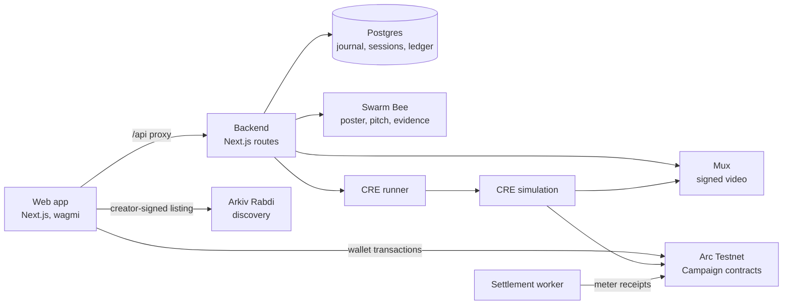

# Cinevest

Film financing and pay-as-you-watch distribution on testnets. Creators raise test USDC in escrow, milestones release the money, and viewers pay only for what they watch.

> **Testnets only.** Test USDC has no monetary value, and backer returns are capped, not guaranteed.

## Contents

- [How it works](#how-it-works)
- [Architecture](#architecture)
- [Sponsor integrations](#sponsor-integrations)
- [Repository layout](#repository-layout)
- [Getting started](#getting-started)
- [Environment](#environment)
- [Commands](#commands)
- [Demo](#demo)
- [Deployment](#deployment)
- [Documentation](#documentation)
- [AI disclosure](#ai-disclosure)

## How it works

1. **Publish.** A creator fills in `/create`. The poster and pitch go to Swarm, the campaign deploys on Arc, and the creator's own wallet lists the film on Arkiv.
2. **Fund.** Backers contribute test USDC to the campaign's escrow. If the goal is missed, they refund their exact principal.
3. **Produce.** Funds release in three tranches of 30%, 40% and 30%. An independent reviewer approves each milestone.
4. **Review the release.** Before final approval, Chainlink CRE checks Arc commitments and Mux delivery. The reviewer still makes the decision and signs it.
5. **Watch.** Viewers buy the film outright, or deposit refundable USDC and pay per 5-second block, never more than the full price.
6. **Earn.** Viewing revenue splits between backers and the creator, with a hard repayment cap for backers.

## Architecture



| Layer | Responsibility |
| --- | --- |
| Arc | Funding, milestones, purchases, viewing escrow and revenue. Funds are decided by the contract, not a server. |
| Arkiv | Creator-owned film listings that anyone can query, including the read-only `/explorer` page. |
| Swarm | Poster, pitch and evidence bytes, with their digests committed on Arc. |
| Mux | Signed video delivery. Metered films stream through the backend's HLS gateway. |
| Postgres | Publication journal, wallet sessions and the viewing ledger. |

## Sponsor integrations

| Sponsor | Use | Details |
| --- | --- | --- |
| **Arc** | Settlement. Factory `0x72503029b6e59c2281f831c6dd8aa1788be5a9c7` on chain 5042002. | [Deployment manifest](contracts/deployments/arc-testnet.json) |
| **Arkiv** | Discovery on Rabdi through `Cinevest.film.v1` entities. | [Schema](arkiv/schema.md), [why Arkiv](arkiv/why-arkiv.md) |
| **Chainlink CRE** | Release readiness: combines Arc state with Mux checks before final review. | [CRE setup and trust boundaries](docs/cre.md) |

Swarm provides storage ([notes](arkiv/swarm.md)). The CRE workflow runs through the CLI as a local simulation; it is not a deployed DON or a production oracle.

World verification is retired and its endpoints return HTTP 410. Existing World-gated contracts keep their immutable restrictions, and new campaigns use public funding.

## Repository layout

| Path | Contents |
| --- | --- |
| `apps/web` | Next.js App Router, Tailwind CSS 4, shadcn-style UI, wagmi and viem. |
| `apps/backend` | Route handlers for sessions, media, viewing, Swarm, Arkiv and the release check. |
| `contracts` | Foundry project with `Campaign` and `CampaignFactory`. |
| `cre` | Chainlink CRE workflow and its authenticated local runner. |
| `packages/abi` | ABIs and the deployment address, generated from Foundry output. |
| `arkiv` | Arkiv schema and sponsor criteria files. |
| `docs` | Runbook, fixtures, audits and integration guides. |
| `scripts` | Deployment, ABI generation and claim tracing. |

## Getting started

### Prerequisites

- Node.js 22.9 or later and npm. The settlement worker needs a Node release that supports `--use-env-proxy`; it was run on Node 26.
- [Foundry](https://getfoundry.sh) for contracts.
- Docker for the local Bee node.
- A Postgres database, a Mux account and an Arkiv access key.
- Bun and the [CRE CLI](https://docs.chain.link/cre/getting-started/cli-installation/macos-linux) for building and running release review.

Run the following commands from the repository root.

### 1. Configure the apps

```sh
npm install
cp apps/web/.env.example apps/web/.env.local
cp apps/backend/.env.example apps/backend/.env.local
```

Fill in both files using the [environment guide](#environment) below. Database migrations require `DATABASE_URL_UNPOOLED` to point to a direct PostgreSQL connection.

### 2. Migrate the database and start the apps

```sh
npm run db:migrate -w @cinevest/backend
npm run dev
```

The web app runs at http://localhost:3000 and the backend at http://localhost:3001. The web app proxies `/api/*` to the backend using the server-only `BACKEND_URL`.

### 3. Start Swarm

```sh
cp .env.example .env
```

Set `BEE_PASSWORD` and the blockchain RPC endpoint in `.env`, then start Bee:

```sh
docker compose -f compose.yml up -d bee
```

The node needs a usable postage batch; see the [Swarm node guide](docs/swarm-node.md).

### 4. Start the CRE runner

```sh
npm ci --prefix cre
npm run cre:build
cp cre/.env.example cre/.env
```

Configure `cre/.env`, including the CLI path and Mux read-only credentials. `CRE_RUNNER_SECRET` must be identical in `cre/.env` and `apps/backend/.env.local`. Set the backend's `CRE_RUNNER_URL` to `http://127.0.0.1:2020/verify`. See [docs/cre.md](docs/cre.md).

Log in with `cre login` (or the executable configured in `CRE_BIN`), then start the runner in a separate terminal:

```sh
npm run cre:runner
```

### 5. Start the settlement worker

In another terminal, run:

```sh
npm run viewing:settle:watch -w @cinevest/backend
```

The worker periodically settles metered usage on Arc. It needs `METER_PRIVATE_KEY`, and that wallet needs Arc gas.

## Environment

Never commit `.env`, `.env.local` or `cre/.env`.

| File | Values |
| --- | --- |
| `apps/backend/.env.local` | `DATABASE_URL`, `DATABASE_URL_UNPOOLED`, `APP_URL`, Arc RPC, Swarm, session secret, Mux, Arkiv, `METER_PRIVATE_KEY`, CRE runner URL and secret |
| `apps/web/.env.local` | Public app settings and `BACKEND_URL` |
| `cre/.env` | Runner secret, `CRE_BIN`, and a separate Mux token with Video read-only permission |
| `.env` | `BEE_PASSWORD` and the Bee blockchain RPC endpoint |

A factory accepts `configureMeterSigner` only once, so `METER_PRIVATE_KEY` must match the signer set on the current factory. Without it, the backend reports films as not metered and viewers use full purchase.

## Commands

| Command | Purpose |
| --- | --- |
| `npm run dev` | Run the web app and backend |
| `npm run build` | Build every workspace |
| `npm run typecheck` | Type-check every workspace |
| `npm run lint` | Lint apps and packages |
| `npm run contracts:build` | Compile contracts |
| `npm run contracts:test` | Run Foundry tests |
| `npm run contracts:abi` | Compile and regenerate ABIs |
| `npm test -w @cinevest/backend` | Run backend tests |
| `npm run db:migrate -w @cinevest/backend` | Apply database migrations |
| `npm run viewing:settle -w @cinevest/backend` | Run one settlement pass |
| `npm run viewing:settle:watch -w @cinevest/backend` | Settle every 5 minutes |
| `npm run cre:typecheck` | Type-check the CRE workflow |
| `npm run cre:build` | Compile the CRE workflow with Bun |
| `npm run cre:runner` | Start the CRE runner |

## Demo

`/demo` has a guided walkthrough and the Circle faucet link. Use your own test wallets for the three roles: creator, backer and reviewer. The reviewer must be a different wallet from the creator.

| Page | Purpose |
| --- | --- |
| `/create` | Publish a campaign in two steps: film proposal, then finance terms |
| `/discover` | Browse films, verified against Arc |
| `/explorer` | Read Arkiv listings directly |
| `/film/5042002/<campaign>` | Fund, review milestones and claim |
| `/watch/5042002/<campaign>` | Buy or pay as you watch, and refund unused balance |

Live transaction evidence is in [docs/fixtures.md](docs/fixtures.md).

## Deployment

Deploy `apps/web` and `apps/backend` as separate Vercel projects, each with its own root directory and workspace dependencies retained. Set `BACKEND_URL` on the web project to the deployed backend URL.

The CRE runner and settlement worker are long-running processes, so they need their own host. Put the runner behind HTTPS and set `CRE_RUNNER_URL` to its `/verify` endpoint.

## Documentation

| Document | Covers |
| --- | --- |
| [Operations runbook](docs/runbook.md) | Running, recovering and monitoring the system |
| [Chainlink CRE](docs/cre.md) | Setup, application flow and trust boundaries |
| [Pay-per-view](docs/pay-per-view.md) | Metering flow, billing rules and accounting |
| [Testnet fixtures](docs/fixtures.md) | Campaigns and transactions from live runs |
| [Release safety audit](docs/release-safety-audit.md) | Trust assumptions |
| [Swarm node guide](docs/swarm-node.md) | Running Bee |
| [Arkiv schema](arkiv/schema.md) | Listing format |

## AI disclosure

This project was built with AI coding assistance (Claude, plus other models under human review), and verified against live testnets.
